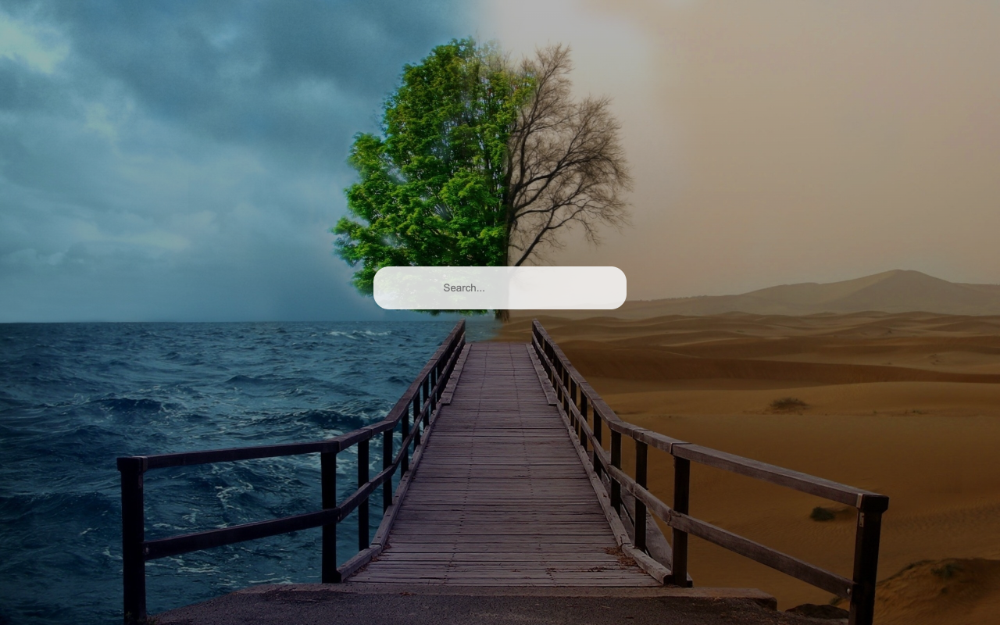

# PWA Searching City

A small Progressive Web App (PWA) built with React that shows the current weather for any city, using the [OpenWeatherMap API](https://openweathermap.org/current).



<details>
<summary>Mobile</summary>


</details>

## Features

- Search a city and press **Enter** to see its current temperature (°C), country and weather condition with an icon
- Installable as a PWA (web app manifest and app icon)
- Service worker caches the app shell and shows an offline page when there is no connection

## Getting started

Requirements: Node.js 14 (see `.tool-versions`) and Yarn.

1. Get a free API key from [OpenWeatherMap](https://home.openweathermap.org/api_keys).
2. Create your env file and add the key:

   ```bash
   cp .env.example .env
   # then set REACT_APP_OPENWEATHER_API_KEY in .env
   ```

3. Install and run:

   ```bash
   yarn install
   yarn start
   ```

Open [http://localhost:3000](http://localhost:3000).

## Configuration

| Variable | Description |
| -------- | ----------- |
| `REACT_APP_OPENWEATHER_API_KEY` | Your OpenWeatherMap API key |

Note: `REACT_APP_*` variables are embedded into the client bundle at build time, so the key is visible in the browser. Use a key you are fine exposing, or proxy requests through a backend for production.

## Scripts

| Command | Description |
| ------- | ----------- |
| `yarn start` | Start the dev server |
| `yarn build` | Build for production into `build/` |
| `yarn test` | Run tests |

To try installing the app and the offline page, run a production build and serve it (e.g. `npx serve -s build`).

## Project structure

```
public/
├── index.html          # Registers the service worker
├── manifest.json       # PWA manifest
├── serviceWorker.js    # Caching and offline fallback
├── offline.html        # Shown when offline
└── images/
src/
├── App.js              # Search input and weather card
├── App.css
├── index.js
├── assets/bg.jpg       # Background image
└── api/fetchWeather.js # OpenWeatherMap client
docs/screenshots/
```
